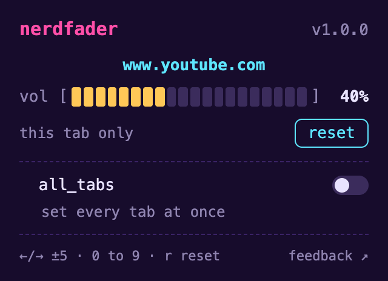

<p align="center"></p>

# Nerdfader

**A volume slider for every browser tab.**

Nerdfader is a small, free, open-source browser extension for Arc, Chrome and other Chromium browsers. Click its
icon, drag the slider, and that tab gets quieter. That's it: no tab capture, no "this tab is being shared"
highlight, no extra windows.

Made for the [Nerdative](https://www.youtube.com/@nerdative) channel on YouTube, by the same person as
[Nerdwave](https://github.com/grumpitect/nerdwave).

<p align="center"></p>

## Features

- **One slider per tab.** 0 to 100%. Each tab remembers its volume across reloads and navigation, until you close it.
- **Reset.** One click (or **r**) puts the tab back to 100%.
- **all_tabs.** Turn it on and one slider sets every tab, including ones you open later. Turn it off and every
  tab goes back to the volume it had before.
- **Badge.** The toolbar icon shows the tab's volume when it isn't 100%.
- **Keyboard and mouse wheel.** ←/→ change by 5% (hold Shift for 1%), **0** to **9** jump to 0 to 90%,
  **r** resets, and scrolling over the popup works too.
- **The site doesn't notice.** YouTube's own volume slider keeps working and keeps showing its own value;
  Nerdfader scales whatever the site plays.
- **Even-feeling slider.** It uses the same curve as VLC and Nerdwave, so 50% sounds about half as loud instead
  of barely quieter.

## Install

**One command** (macOS; installs or updates to the latest release):

```bash
curl -fsSL https://raw.githubusercontent.com/grumpitect/nerdfader/main/install.sh | bash
```

[install.sh](install.sh) downloads the latest release, checks its SHA-256 against the one in the release notes, and
puts the extension in `~/Library/Application Support/Nerdfader/extension`. It only uses tools that come with macOS;
read it first if you like.

**By hand** (any OS): grab the latest **Nerdfader-x.y.z.zip** from
[Releases](https://github.com/grumpitect/nerdfader/releases/latest) and unzip it somewhere it can stay.

**Then, once, load it in your browser:**

1. Open `arc://extensions` in Arc (or `chrome://extensions` in Chrome, Brave, Edge...).
2. Turn on **Developer mode**, click **Load unpacked**, and choose the **Nerdfader** folder
   (the one the install command printed, or the one you unzipped).
3. Pin it to your toolbar so the slider is one click away.

Tabs that were already open start working right away. **Updating:** run the install command again (or replace the
folder), then click the reload arrow on Nerdfader's card or restart the browser. Your settings stay.

## How it works

Browsers give extensions two ways to change a tab's volume. One is to capture the tab's audio (what Volume Master
does), which is why those extensions highlight the tab as being shared and can boost past 100%. Nerdfader uses
the other: a small script inside each page (and each frame in it) that scales the page's own sound.

- **`<audio>` and `<video>`:** the element plays at the site's volume times yours. The site still reads back the
  volume it set, so its own controls don't jump.
- **Web Audio** (games, some players): sound headed for the speakers passes through one extra gain stage per
  audio context, which glides to the new level so dragging doesn't click.

The trade-offs: it can't make a tab louder than the site plays it, and it can't reach pages the browser keeps
extensions out of (`arc://` and `chrome://` pages, the Chrome Web Store). Sound from plugins or from other
extensions isn't affected either.

Nerdfader asks for **access to all sites** because it has to run that script in whatever page you're on, and
**storage** to remember volumes. It sends nothing anywhere: there is no network code in it.

Volumes live in the browser's extension storage. A tab's own volume lasts until the tab closes or the browser quits;
the all_tabs switch and its volume are remembered across restarts.

## Development

```bash
git clone https://github.com/grumpitect/nerdfader.git
cd nerdfader
npm install            # Playwright, for the tests only; the extension has no dependencies
npx playwright install chromium
npm test               # loads the extension into Chromium and checks what pages actually play at
```

To try a change, load the `extension` folder with **Load unpacked** and click the reload arrow after editing.

- `extension/content/main.js`: runs in the page's world; patches media volume and Web Audio.
- `extension/content/bridge.js`: runs in the extension's world; passes the level from the background to the page.
- `extension/background.js`: remembers each tab's volume and the all_tabs override, and pushes levels to tabs.
- `extension/popup/`: the slider.
- `Tools/make_icon.py`: regenerates the icons (`pip install pillow numpy`, then `python3 Tools/make_icon.py extension/icons`;
  `python3 Tools/make_icon.py --png docs/nerdfader-icon.png 1024` renders the README version).
- `SCREENSHOT=docs/popup.png npm test` re-renders the popup screenshot.

Maintainers publish a release with `./release.sh` (patch bump by default; `minor`, `major` or an exact `X.Y.Z`
also work). It runs the tests, bumps the version in `manifest.json`, zips the extension, tags, pushes and creates
the GitHub release.

## Feedback

Found a site where it doesn't work, or have an idea? Click **feedback** in the popup, or
[open an issue](https://github.com/grumpitect/nerdfader/issues/new/choose).

## License

[MIT](LICENSE).
