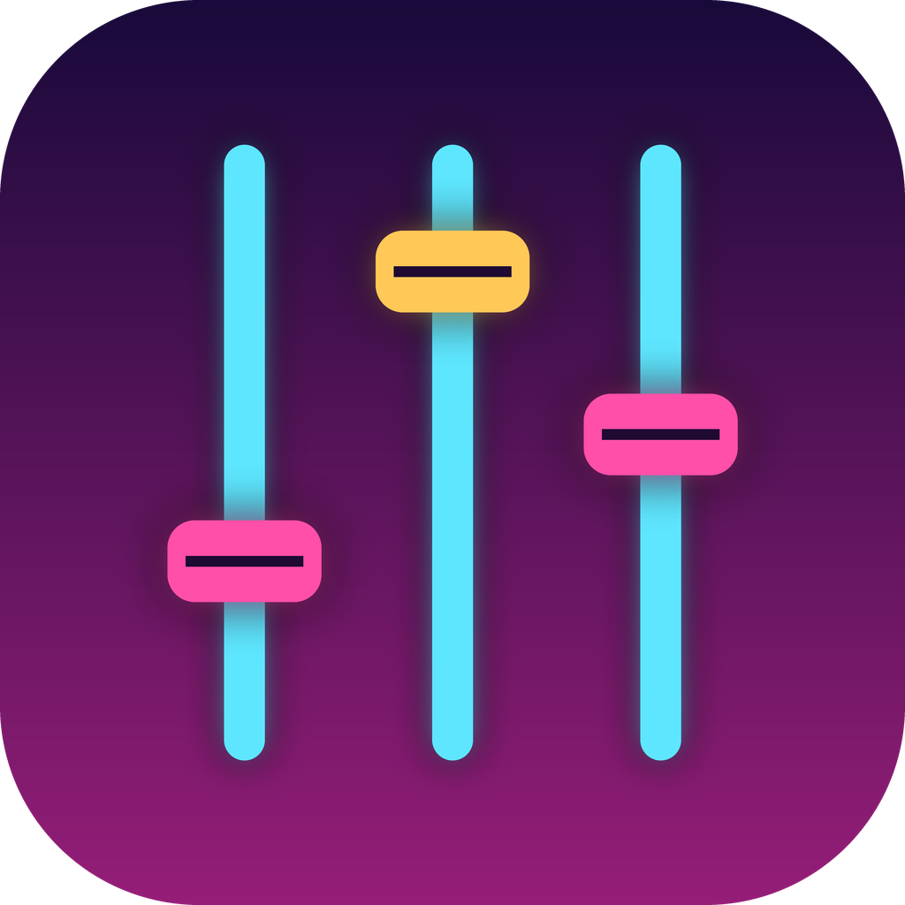
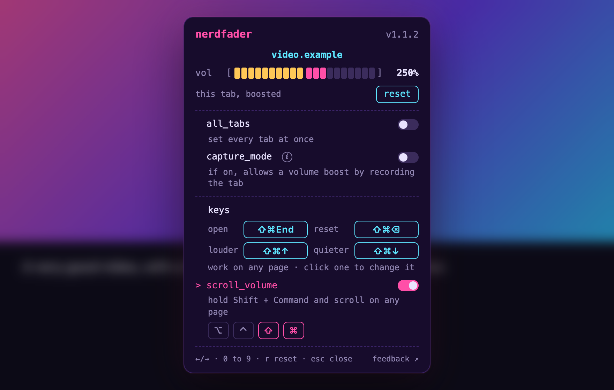

<p align="center"></p>

# Nerdfader

**A volume slider for every browser tab, from 0 to 600%.**

Nerdfader is a small, free, open-source browser extension for Arc, Chrome and other Chromium browsers. Click its
icon, and a small dialog opens in the middle of the page over a blurred backdrop. Drag the slider, and that tab
gets quieter (or louder). Click anywhere outside it, press Esc, or click the icon again to close it. Most sites are boosted from inside the page, with no
"this tab is being shared" highlight; capture mode is only used, with your OK, for the few sites that block that.

Made for the [Nerdative](https://www.youtube.com/@nerdative) channel on YouTube, by the same person as
[Nerdwave](https://github.com/grumpitect/nerdwave).

<p align="center"></p>

## Features

- **One slider per tab.** 0 to 600%. Each tab remembers its volume across reloads and navigation, until you close it.
- **Boost without distortion.** Above 100% a limiter holds loud parts down instead of letting them crackle.
  600% is 6x (+15.6 dB), the same scale as other boosters.
- **Capture mode, only when needed.** Netflix, Spotify and other DRM sites (and media served from another site
  without permission to process it) can't be boosted from inside the page. For those, Nerdfader offers capture
  mode: once for that tab, or always. It runs only while the tab plays sound: it stops a moment after the tab
  pauses or goes quiet, and starts again when it plays.
- **Reset.** One click (or **r**) puts the tab back to 100%.
- **Opens over the page.** The dialog sits in the page, centered over a blurred backdrop, and shows above
  fullscreen video too. Keys you type in it don't reach the page, so a video player won't also seek. On pages
  extensions can't touch (`arc://` and `chrome://` pages, the Web Store) the icon opens a regular popup instead.
- **all_tabs.** Turn it on and one slider sets every tab, including ones you open later. Turn it off and every
  tab goes back to the volume it had before.
- **Badge.** The toolbar icon shows the tab's volume when it isn't 100%.
- **Keyboard and mouse wheel.** ←/→ change by 5% (25% above 100%; hold Shift for finer steps), **0** to **9**
  jump to 0 to 90%, **r** resets, **Esc** closes, and scrolling over the dialog works too.
- **The site doesn't notice.** YouTube's own volume slider keeps working and keeps showing its own value;
  Nerdfader scales whatever the site plays.
- **Even-feeling slider.** Below 100% it uses the same curve as VLC and Nerdwave, so 50% sounds about half as
  loud instead of barely quieter. The first half of the bar is 0 to 100%, the second half 100 to 600%.

## Install

**One command** (macOS; installs or updates to the latest release):

```bash
curl -fsSL https://raw.githubusercontent.com/grumpitect/nerdfader/main/install.sh | bash
```

[install.sh](install.sh) downloads the latest release, checks its SHA-256 against the one in the release notes, and
puts the extension in `~/Library/Application Support/Nerdfader/extension`. It only uses tools that come with macOS;
read it first if you like.

**By hand** (any OS): grab the latest **Nerdfader-x.y.z.zip** from
[Releases](https://github.com/grumpitect/nerdfader/releases/latest) and unzip it somewhere it can stay.

**Then, once, load it in your browser:**

1. Open `arc://extensions` in Arc (or `chrome://extensions` in Chrome, Brave, Edge...).
2. Turn on **Developer mode**, click **Load unpacked**, and choose the **Nerdfader** folder
   (the one the install command printed, or the one you unzipped).
3. Pin it to your toolbar so the slider is one click away.

Tabs that were already open start working right away. **Updating:** run the install command again (or replace the
folder), then click the reload arrow on Nerdfader's card or restart the browser. Your settings stay, and open tabs
switch to the new version on their own. (Coming from 1.0.0, reload tabs that were open during the update once.)

## How it works

Browsers give extensions two ways to change a tab's volume. One is to capture the tab's audio (what Volume Master
does), which highlights the tab as being shared. Nerdfader uses the other whenever it can: a small script inside
each page (and each frame in it) that scales the page's own sound.

- **`<audio>` and `<video>`:** the element plays at the site's volume times yours. The site still reads back the
  volume it set, so its own controls don't jump. Above 100%, the element's sound goes through a gain stage and a
  limiter (Web Audio).
- **Web Audio** (games, some players): sound headed for the speakers passes through the same gain stage, which
  glides to the new level so dragging doesn't click.

The browser won't let a page's script process three kinds of sound, so those can't be boosted from inside:
protected (DRM) media, media from another site that doesn't allow it, and sound in a page you haven't clicked yet
(clicking anywhere in it fixes that one). Nerdfader detects these, keeps them at up to 100% instead of silencing
them, and the popup offers **capture mode**:

- The tab's sound is captured and played back louder from a hidden extension page. The browser shows the tab as
  shared while this runs.
- It runs only while needed. It stops a moment (1.5 s) after the tab pauses, or after 3 s of silence, and starts
  again when the tab plays. It also stops right away when you go back to 100% or below.
- The browser only lets an extension capture a tab after you've clicked the extension on that tab. If it refuses
  to restart capture later (for example after the tab moved to a new page), the tab plays at 100% and opening the
  popup on it resumes the boost.

Nerdfader can't reach pages the browser keeps extensions out of (`arc://` and `chrome://` pages, the Chrome Web
Store). Sound from plugins or from other extensions isn't affected either.

**Permissions.** Access to all sites, to run that script in whatever page you're on; storage, to remember volumes;
tab capture and an offscreen page, for capture mode. Nerdfader sends nothing anywhere: there is no network code in it.

Volumes live in the browser's extension storage. A tab's own volume lasts until the tab closes or the browser quits;
the all_tabs and capture_mode switches are remembered across restarts.

## Development

```bash
git clone https://github.com/grumpitect/nerdfader.git
cd nerdfader
npm install            # Playwright, for the tests only; the extension has no dependencies
npx playwright install chromium
npm test               # loads the extension into Chromium and measures what tabs actually play at
```

The tests switch the browser's audio output off (pages still play and can be captured) and measure each tab's
real output with tab capture, so they're silent.

```bash
npm run test:real      # the same in your installed Google Chrome, the way a person uses it
```

`test:real` starts Google Chrome with a throwaway profile and drives it over its debugging protocol, which can load
the extension and click its toolbar icon for real. It installs 1.0.0 and updates it over open tabs, reloads it while
tabs play, opens the dialog, runs capture mode under Chrome's real "only after you clicked it on this tab" rule,
plays a DRM (ClearKey) stream, and visits YouTube, Vimeo, Facebook and Twitch, failing on anything that shows up
under Errors in chrome://extensions. A Chrome window is open while it runs. Set `CHROME` to use another
Chromium-based browser's binary.

To try a change, load the `extension` folder with **Load unpacked** and click the reload arrow after editing.

- `extension/content/main.js`: runs in the page's world; patches media volume and Web Audio, boosts, and reports
  what it can't boost.
- `extension/content/bridge.js`: runs in the extension's world; passes the level from the background to the page.
- `extension/background.js`: remembers each tab's volume and the switches, pushes levels to tabs, and decides when
  capture mode runs.
- `extension/offscreen/`: capture mode's playback, limiter and silence detection.
- `extension/ui/panel.js`: the panel (slider, reset, switches, capture offer), shared by the dialog and the popup.
- `extension/ui/overlay.js`: the in-page dialog.
- `extension/popup/`: the toolbar popup, for pages the dialog can't open in.
- `Tools/make_icon.py`: regenerates the icons (`pip install pillow numpy`, then `python3 Tools/make_icon.py extension/icons`;
  `python3 Tools/make_icon.py --png docs/nerdfader-icon.png 1024` renders the README version).
- `SCREENSHOT=docs/dialog.png npm test` re-renders the README screenshot.

Maintainers publish a release with `./release.sh` (patch bump by default; `minor`, `major` or an exact `X.Y.Z`
also work). It runs the tests, bumps the version in `manifest.json`, zips the extension, tags, pushes and creates
the GitHub release.

## Feedback

Found a site where it doesn't work, or have an idea? Click **feedback** in the popup, or
[open an issue](https://github.com/grumpitect/nerdfader/issues/new/choose).

## License

[MIT](LICENSE).
